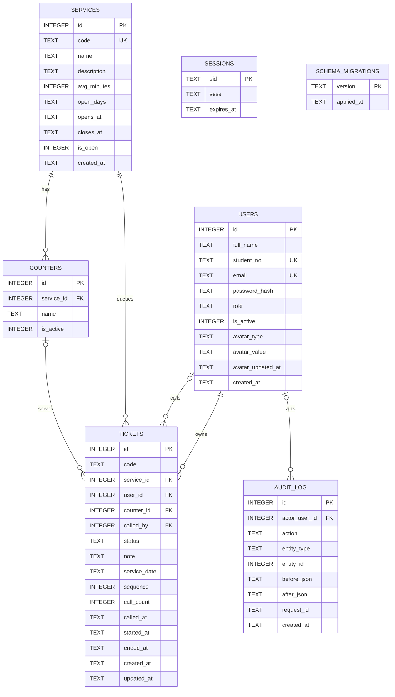
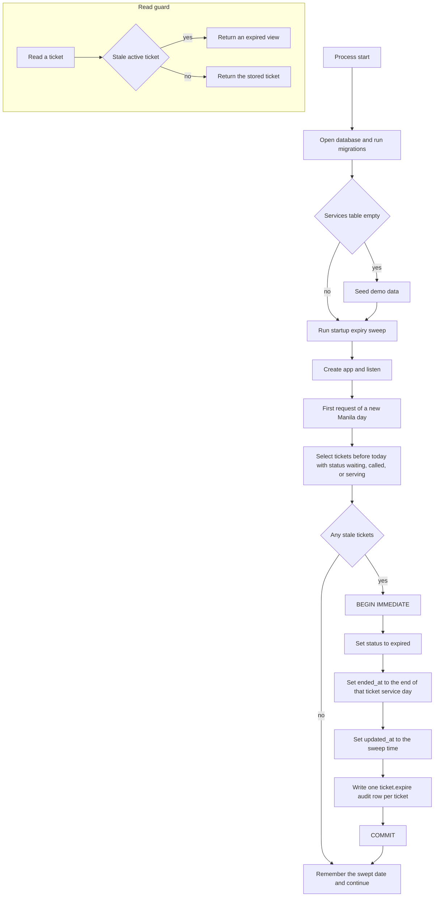

# Qampus

Server-rendered queueing system for the CSPC CCIT 106 midterm. Node.js 22.12 or newer, Express 4, EJS, and SQLite through better-sqlite3.

## Requirements

- Node.js 22.12 or newer. Node 24 is supported and is the version pinned in `.nvmrc`.
- npm 10 or newer

## Setup

```bash
npm ci
npm start
```

On the first start the app creates `data/cspc_queue.sqlite`, applies the schema, and seeds the demo data, because the server seeds whenever the services table is empty. It listens on `http://localhost:3000`, and `/health` returns `{"status":"ok","db":"ok"}`.

A `.env` file is optional in development. Copy `.env.example` to `.env` when you need a different port, a real `SESSION_SECRET`, mail settings, or the hours flag below.

Account mail uses Ethereal in development and Brevo in production. Registration sends an 8-digit code, and the server log prints an Ethereal preview URL you can open to read it. Production requires the mail keys and a verified sender domain; see `docs/08-deployment.md`.

## Environment

| Variable | Default | Notes |
| --- | --- | --- |
| `NODE_ENV` | `development` | `production` enforces a strong secret and secure cookie |
| `PORT` | `3000` | HTTP port |
| `DATABASE_PATH` | `data/cspc_queue.sqlite` | SQLite file, created on first run |
| `SESSION_SECRET` | development fallback | At least 32 characters in production |
| `COOKIE_NAME` | `cspc_queue.sid` | Session cookie name |
| `SESSION_MAX_AGE_MS` | `28800000` | 8 hours |
| `COOKIE_SECURE` | `false` | Forced on in production |
| `QUEUE_ENFORCE_HOURS` | `true` | Joining respects Mon to Fri and 08:00 to 17:00 Manila. Set `false` for demos outside office hours |
| `LOG_LEVEL` | `info` | pino level, `silent` in tests |
| `MAIL_DRIVER` | `ethereal` | `brevo` is required in production; tests use `memory` |
| `MAIL_FROM` | Qampus sender | Must be on the verified Brevo domain in production |
| `BREVO_API_KEY` | empty | Required when `MAIL_DRIVER=brevo` |
| `MAIL_ENCRYPTION_KEY` | dev fallback | 32-byte base64 key; required in production |
| `AUTH_PEPPER` | dev fallback | 32+ character HMAC key; required in production |
| `OTP_TTL_MINUTES` | `10` | Verification and reset code lifetime |
| `OTP_MAX_ATTEMPTS` | `5` | Wrong-code tries before the code is replaced |
| `OTP_RESEND_COOLDOWN_SECONDS` | `60` | Minimum wait before another code |

## Scripts

| Command | Purpose |
| --- | --- |
| `npm start` | Start the server |
| `npm run dev` | Start with `node --watch` |
| `npm test` | Full Vitest and Supertest run |
| `npm run test:watch` | Vitest in watch mode |
| `npm run lint` | ESLint over the app source, tests, and scripts |
| `npm run demo:reset` | Rebuild the deterministic demo database |
| `npm run demo:verify` | Check the demo counts and password hash |
| `npm run db:migrate` | Apply schema migrations |
| `npm run db:seed` | Seed an existing database |
| `npm run db:reset` | Delete the database file, migrate, and seed |
| `npm run load` | Fetch `/health` repeatedly with Node 22 fetch |

## Demo accounts

Every demo account uses the password `QueueDemo2026!` and is seeded as verified.

| Role | Email |
| --- | --- |
| Staff | `staff@my.cspc.edu.ph` |
| Office head | `admin@my.cspc.edu.ph` |
| Student | `student1@my.cspc.edu.ph` to `student6@my.cspc.edu.ph` |

The seed creates 4 services (REG 8 min, CSH 5 min, SCH 10 min, LIB 4 min), one counter per service, 1 staff, 1 office head, 6 students, and 6 waiting tickets. The password is a hardcoded demo constant, so change it before any deployment that is not a class demo.

## Demo walkthrough

1. Run `npm run demo:reset` on demo day. Seeded tickets carry the service date of the day the database was created, so an old file leaves the board empty on a later day.
2. Outside Mon to Fri 08:00 to 17:00 Manila, start with `QUEUE_ENFORCE_HOURS=false npm start` in bash, or `$env:QUEUE_ENFORCE_HOURS='false'; npm start` in PowerShell, or the join buttons refuse.
3. Sign in as `student1@my.cspc.edu.ph` and open `/queue`. The seed already gives this student ticket `REG-001`, so open that ticket; joining Registrar again reports that you already hold one.
4. In a private window or another browser, sign in as `staff@my.cspc.edu.ph`, open `/staff/queue`, and press Call next for that window.
5. The student ticket page updates within 10 seconds, shows "Your turn", and plays the two chime call alert. Tap the page once before the call, because browsers block audio until a gesture; the `Sound on` toggle above the ticket shows and saves the choice, and turns into `Turn on sound` if the browser blocks playback.
6. Sign in as `admin@my.cspc.edu.ph` to manage windows and staff accounts at `/admin/services` and `/admin/staff`.

## Tests

```bash
npm test
npm run lint
npm run demo:verify
```

Unit tests pin the pure rules (codes, position, ETA, transitions, schemas, time). Integration tests run Supertest against a real SQLite file per worker and cover routing, sessions, CSRF, authorization, rate limits, and database constraints. There is no browser end-to-end suite; the call alert sound needs a real browser and a listener, which is manual test M04 in the project test plan.

## Continuous integration

Every pull request and push to `master` runs `.github/workflows/ci.yml` on Node 22 and Node 24. Each job checks lint, tests, generated asset drift, and the demo reset and verify path. It does not deploy.

## Troubleshooting

- The board is empty: run `npm run demo:reset` on the day of the demo and reload.
- Joining is refused: the window is closed by day or time. Start with `QUEUE_ENFORCE_HOURS=false` for a demo.
- No alert sound: browsers block audio until the visitor interacts. Tap the page or the `Sound on` toggle, and check the tab is not muted.
- The port is taken: `PORT=3001 npm start`.
- You want a clean database: `npm run demo:reset`, or delete `data/cspc_queue.sqlite*` and restart.

## Layout

```text
src/
  app.js          createApp({ db, config })
  server.js       migrate, seed when empty, listen, cleanup, shutdown
  routes.js       home, health, feature routers
  config.js       env parsing and production guards
  core/           db, schema, errors, logger, security, sessions, validation, audit, context, time, seed
  modules/auth/   register, verification, password reset, login, logout
  modules/queue/  student queue routes, dashboard, join and leave
  modules/tickets/ ownership, position, ETA, transitions, audit
  modules/staff/  call, recall, start, serve, no-show
  modules/admin/  service windows and staff accounts
  modules/display/ public board and JSON
public/           css, js, icons, images, audio
views/            layouts, pages, partials
scripts/          db, demo, load
tests/            unit, integration, helpers, fixtures
```

The full design, test plan, and traceability documents live in the repository `docs/` folder and are not part of this test bundle.

## Data model



`tickets.counter_id` and `tickets.called_by` are nullable. `audit_log.actor_user_id` is null for system actions. A ticket is unique by `(service_id, service_date, sequence)` and by `(code, service_date)`. The partial unique index allows only one of `waiting`, `called`, or `serving` per student, service, and day.

## Ticket expiry

A ticket belongs to the Manila service day in `service_date`. When that day ends, an active ticket is stale. The sweep expires stale `waiting`, `called`, and `serving` tickets:

- once at startup after migrations and seeding,
- once on the first request of each new Manila day,
- and on demand with `node scripts/db.js expire` or `node scripts/db.js expire --dry-run`.



The read guard means the UI cannot show a prior-day ticket as usable even before the sweep writes the row. The next sweep persists it. Because sequence and uniqueness are scoped by `service_date`, today's first ticket starts at 1 again while history stays in the table.

## Security notes

- Every POST requires a `_csrf` field that matches the session token with a timing-safe compare.
- Helmet sets a self-only CSP, `X-Frame-Options: DENY`, and `nosniff`.
- Login is limited to 10 attempts per 15 minutes per IP; register to 5 per hour per IP. Verification and reset POSTs are limited per IP and per account.
- New accounts stay unverified until the emailed 8-digit code is entered. Codes are hashed, expire in 10 minutes, and are stored as ciphertext in the mail outbox. A reset ends every old session.
- Sessions live in SQLite. The cookie is HttpOnly, SameSite=Lax, and Secure in production. Login regenerates the session and logout destroys it.
- Role checks and ticket ownership run on the server. Another student's ticket returns 404, not 403.
- Every state change writes an audit row. Time is Asia/Manila for service dates, stored as UTC ISO strings.

## License

MIT. See `LICENSE`.
